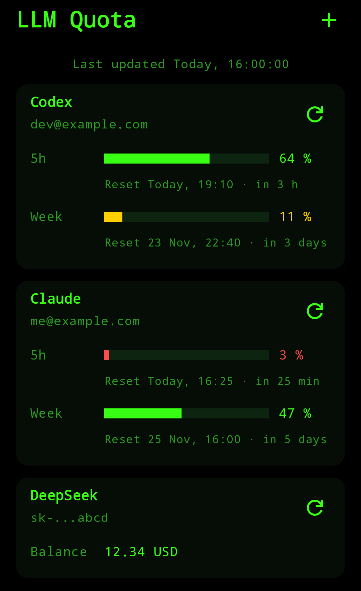

# LLM Quota

An Android app that shows how much quota is left on your LLM accounts: Codex, Claude and DeepSeek, as many accounts as you like, on one screen. The phone queries each provider directly; there is no server.

<p align="center"></p>

---

## 1. Using and Configuring LLM Quota

### Add accounts

Tap `+` in the top bar and pick a provider:

| Provider | Sign-in |
|----------|---------|
| Codex    | Browser sign-in with your ChatGPT account |
| Claude   | Browser sign-in with your Claude account |
| DeepSeek | Paste an API key; it is checked before it is saved |

Browser sign-in opens Chrome when it is installed (Claude rejects the login in some other mobile browsers) and returns to the app on its own. Accounts of the same provider are told apart by their e-mail address, or for DeepSeek by the masked key (`sk-...abcd`).

### Read the dashboard

Each card shows one account: the remaining share of every quota window as a bar with a percentage, the reset time, and for DeepSeek the balance. Window names come from the provider, for example `5h` and `Week`. Bars turn yellow below 15 % and red below 5 %.

- Tap a card to open the provider's usage page.
- Tap the refresh icon on a card to update that account only; pull down to update all.
- Long-press a card for a menu with Refresh and Delete; keep the finger down and drag to reorder.

### Where credentials live

Tokens and API keys are stored on the phone only, in encrypted app storage. The app talks only to the providers' own endpoints.

---

## 2. Contributing and Building

### Prerequisites

- JDK 17 or newer
- Android SDK with platform 36
- A `local.properties` in the project root with `sdk.dir` (Android Studio creates it). Optional overrides for the client IDs:

```properties
sdk.dir=<path to the Android SDK>
# Optional: override the built-in client IDs.
codex.clientId=<OAuth client ID of the Codex CLI>
claude.clientId=<OAuth client ID of the Claude Code CLI>
```

The build falls back to the public client IDs below when an override is missing. The Codex client ID is the `CLIENT_ID` constant in [`codex-rs/login/src/auth/manager.rs`](https://github.com/openai/codex/blob/main/codex-rs/login/src/auth/manager.rs) of the official [openai/codex](https://github.com/openai/codex) repository.

The Claude client ID is the `client_id` in Claude Code's sign-in URL, which [anthropics/claude-code#36215](https://github.com/anthropics/claude-code/issues/36215) quotes.

### Build and verify

```sh
./gradlew :app:assembleDebug          # app/build/outputs/apk/debug/app-debug.apk
./gradlew :app:testDebugUnitTest      # unit tests
```

### Release build

```sh
./gradlew :app:assembleRelease        # app/build/outputs/apk/release/app-release.apk
```

The release build type enables R8 minification, resource shrinking and optimization (`app/proguard-rules.pro`). It is signed with the debug key until a release keystore is configured in `app/build.gradle.kts`, so do not distribute it.


---

## License

MIT. See [LICENSE](LICENSE).
